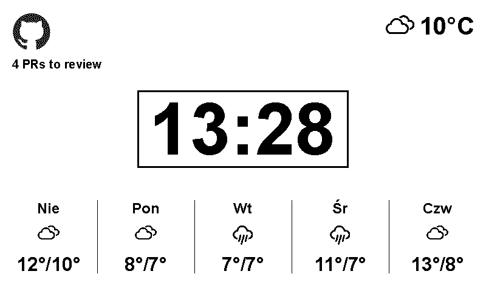

# Waveshare E-ink Info Display

A Raspberry Pi–powered information display on a Waveshare 7.5" (V2) e-paper screen. Rather than cramming everything onto one layout, it rotates through a *playlist* of screens under a persistent header showing the time, date and rotation position:

- **Work** — my open pull requests with review state and CI status, and the queue waiting on my review
- **Weather** — current conditions in detail, the next few hours, and a 5-day forecast
- **Steam** — which friends are playing right now, and what I've been playing



I wrote a blog series about building it:

1. [Informative e-ink display with Raspberry Pi — part 1](https://maikhel.github.io/blog/informative-e-ink-display-with-raspberry-pi-part-1/) — hardware setup and drawing on the screen
2. [Part 2](https://maikhel.github.io/blog/informative-e-ink-display-with-raspberry-pi-part-2/) — rendering the clock and weather layout
3. [Part 3](https://maikhel.github.io/blog/informative-e-ink-display-with-raspberry-pi-part-3/) — fetching live data from GitHub, Steam, and OpenWeather

The posts reference specific stages of this repo — the [`1.0`](../../tree/1.0) tag matches the state described in the series.

## How it works

Two halves that only meet through JSON on disk: services fetch data on their own
schedule, the renderer draws whatever is currently in `data/`.

- `clock.py` — main loop: e-ink lifecycle, refresh policy, night mode
- `eink/` — the renderer
  - `render.py` — composes the header strip plus the active screen
  - `playlist.py` — decides which screen is showing
  - `screens/` — one module per screen, each declaring the data it needs
  - `layout.py`, `theme.py` — layout primitives and the type scale
- `services/` — fetch scripts for weather, GitHub PRs, and Steam friend statuses; each writes JSON to `data/` (run them from systemd timers)
  - `common.py` — credentials, atomic writes, shared error handling
- `playlist.json` — which screens rotate, for how long, and when
- `demo.py` — renders to `preview.png` plus `preview_<id>.png` per screen, without the e-ink hardware, using `example_data/`
- `shutdown.py`, `deep_clean.py` — clear the panel safely / remove ghosting

Screens that have no data, or nothing worth showing, drop out of the rotation
instead of displaying an empty panel.

## Data

Each service writes one file to `data/`, wrapped in an envelope:

```json
{ "source": "github", "fetched_at": "2026-09-22T12:25:11+00:00", "data": {  } }
```

Writes go through a temporary file and a rename, so the renderer can never read
a half-written file. A fetch that fails writes nothing and leaves the previous
result in place.

Services run as rarely as suits them — weather every few hours, Steam hourly —
and old data is simply drawn as-is; `fetched_at` is logged rather than shown, so
a timer that has quietly stopped firing is visible in `clock.log`. Only a missing or
unreadable file takes a screen out of the rotation.

## The playlist

`playlist.json` controls rotation. Each screen has a `dwell` (`"5m"`, `"90s"` or
a plain number of seconds) and an optional `when`, a list of conditions of which
any one matching is enough:

```json
{
  "id": "work",
  "dwell": "5m",
  "when": [{ "days": "weekdays", "hours": [8, 18] }]
}
```

`days` is `all`, `weekdays` or `weekends`; `hours` is `[start, end]` with `start`
inclusive and `end` exclusive. A screen with no `when` is always scheduled.
Rotation is decided only at screen changes, so the panel never reshuffles
mid-slot.

## Setup

1. Install the [Waveshare e-Paper library](https://github.com/waveshareteam/e-Paper) on the Pi, plus `pillow`, `requests`, and `python-dotenv`
2. Copy `.env.example` to `.env` and fill in your API keys and Steam IDs (`STEAM_USER_ID` is your own, for recent playtime)
3. Schedule the `services/` scripts with systemd timers (see below) and run `clock.py` (e.g. as a systemd service)
4. Edit `playlist.json` to choose which screens rotate and when

## Service timers

Each fetch script runs as a oneshot service started by a timer of the same name:
`fetch_weather`, `fetch_github` and `fetch_steam`. A timer like this one runs
every three hours:

```ini
# /etc/systemd/system/fetch_weather.timer
[Timer]
OnBootSec=1min
OnUnitActiveSec=3h
Persistent=true

[Install]
WantedBy=timers.target
```

Prefer `OnBootSec`/`OnUnitActiveSec` over `OnCalendar`: they count elapsed time,
so the clock moving for daylight saving can't affect them. In October 2026 the
timers stopped firing entirely after the switch to winter time, with nothing
logged as an error.

### When data stops updating

A service whose timer has stopped looks healthy: `systemctl status` shows no
error, only a last run that is days old. Check the timers first:

```bash
systemctl list-timers --all | grep fetch_                 # NEXT should be soon, not n/a or in the past
journalctl -u fetch_weather.service -n 50 --no-pager      # the latest runs and any traceback
grep fetched_at data/*.json                               # when each fetch last succeeded
```

Restart the timers so systemd works out the next run again, then start each
service once to fetch now:

```bash
sudo systemctl restart fetch_weather.timer fetch_github.timer fetch_steam.timer
sudo systemctl start fetch_weather.service fetch_github.service fetch_steam.service
```

After editing a unit file, run `sudo systemctl daemon-reload` before restarting.
To see the real error from a failing fetch, run the script by hand as the
service's user, e.g. `python3 services/fetch_github.py; echo $?`. A failed fetch
prints `[ERROR] <source>: ...` and leaves the previous data in place.
